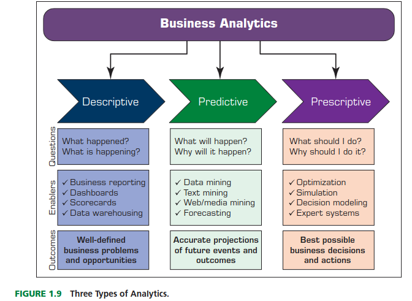
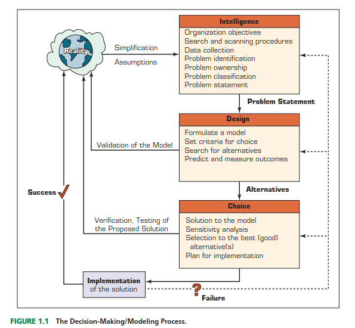
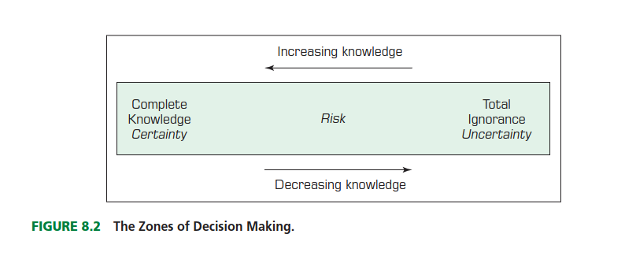
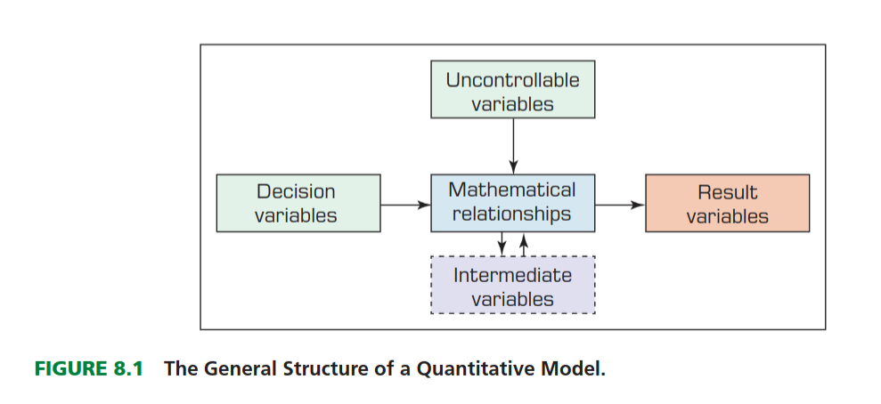

## Toma de decisiones en Business Intelligence



## Toma de desición y soporte en datos

::: {.callout-important}

La toma de decisiones es un proceso de elección **entre dos o más cursos de acción alternativos** con el fin de alcanzar uno o más objetivos. 
:::

- Según Simon (1977), la toma de decisiones gerenciales es sinónimo de todo el proceso de gestión. Consideremos la importante función gerencial de la planificación. 

- La planificación implica una serie de decisiones: ¿Qué se debe hacer? ¿Cuándo? ¿Dónde? ¿Por qué? ¿Cómo? ¿Quién debe hacerlo? 

- Los gerentes establecen objetivos, es decir, planifican; por lo tanto, la planificación implica la toma de decisiones. Otras funciones gerenciales, como la organización y el control, también implican la toma de decisiones.

## El proceso de toma de decisiones



## El proceso de toma de decisiones

::: {.callout-important}

- La fase de selección de alternativas incluye la elección de una solución propuesta para el modelo (no necesariamente para el problema que representa). Esta solución se prueba para determinar su viabilidad.

- Durante este proceso, es necesario predecir el resultado futuro de cada alternativa propuesta.

- Las decisiones las tomamos bajo :
    - Certeza
    - Incertidumbre
    - Riesgo

:::

## Espacio de toma de decisiones según la conocimiento



## Espacio de toma de decisiones según la conocimiento

- En la toma de decisiones **bajo certeza**, se asume que se dispone de información completa, de modo que quien toma la decisión sabe con exactitud cuál será el resultado de cada curso de acción (como en un entorno determinista).

- En la toma de decisiones en **condiciones de incertidumbre**, quien toma la decisión considera situaciones en las que son posibles varios resultados para cada curso de acción. 

- Una **decisión tomada bajo riesgo** es aquella en la que quien toma la decisión debe considerar varios resultados posibles para cada alternativa, cada uno con una probabilidad de ocurrencia determinada.

# Análisis Cuantitativo {background-color="#790cee"}

## Modelar la toma de decisiones



## Modelar la toma de decisiones

- Un modelo matemático es una **representación simplificada** de la realidad que utiliza el lenguaje, los símbolos y las estructuras de las matemáticas para describir, explicar o predecir el comportamiento de un sistema.

- Optimizar: Encontrar la mejor forma de asignar recursos.
- Predecir: Anticipar escenarios futuros bajo condiciones específicas.
- Controlar: Entender qué palancas mover para obtener un resultado deseado.


## Evaluación de alternativas

Para evaluar con rigor distintas alternativas de acción en BI, es fundamental integrar:

1.  **Rigor Estadístico:** Mediante simulaciones.
2.  **Flexibilidad:** Incorporando criterios cualitativos.
3.  **Robustez:** Entendiendo el impacto de la incertidumbre.

## El Modelado de la incertidumbre

El núcleo de la evaluación reside en entender cómo varían los **KPIs** ante cambios en los supuestos de entrada.

- **Análisis de sensibilidad:** Identifica qué variables generan mayor variación de los indicadores clave. Se debe definir valores mínimimos y máximos como supuestos o escenarios.
- **Simulación de Monte Carlo:** Genera rangos de probabilidad en lugar de números estáticos. Útil para ver en términos de probabilidad todos los escenarios posibles.

## Análisis de sensibilidad (Tornado)

- Un gráfico tornado es una representación visual que muestra el impacto de múltiples variables independientes en una variable dependiente. 
- Se utiliza principalmente en análisis de sensibilidad, permitiendo identificar cuáles variables tienen el mayor impacto en el resultado final. 

**Análisis unidireccional**
Variar una sola variable (ej. precio o costo) manteniendo las demás constantes.

**Diagramas de tornado**
Ranking de variables por su impacto en el resultado final.

## Tornado: Ejemplo de Análisis de Sensibilidad

- **Variable 1: Precio de venta**
    - Rango: $100 - $150
- **Variable 2: Costo de producción**
    - Rango: $50 - $80
- **Variable 3: Volumen de ventas**
    - Rango: 1000 - 1500 unidades
- **Resultado:** Impacto en la utilidad neta

## Gráfico Tornado en python

```{python}
import matplotlib.pyplot as plt
import pandas as pd

# 1. Configuración de valores base (promedios del rango)
base_precio = 125  # (100+150)/2
base_costo = 65  # (50+80)/2
base_volumen = 1250  # (1000+1500)/2


def calcular_utilidad(precio, costo, volumen):
    return (precio - costo) * volumen


utilidad_base = calcular_utilidad(base_precio, base_costo, base_volumen)

# 2. Definición de Rangos (Mínimo, Máximo)
variables = {
    "Precio de venta": [100, 150],
    "Costo de producción": [80, 50],
    "Volumen de ventas": [1000, 1500],
}

# 3. Cálculo de impactos
impactos = []
for var, rango in variables.items():
    if var == "Precio de venta":
        u_min = calcular_utilidad(rango[0], base_costo, base_volumen)
        u_max = calcular_utilidad(rango[1], base_costo, base_volumen)
    elif var == "Costo de producción":
        u_min = calcular_utilidad(base_precio, rango[0], base_volumen)
        u_max = calcular_utilidad(base_precio, rango[1], base_volumen)
    elif var == "Volumen de ventas":
        u_min = calcular_utilidad(base_precio, base_costo, rango[0])
        u_max = calcular_utilidad(base_precio, base_costo, rango[1])

    impactos.append(
        {
            "Variable": var,
            "Bajo": u_min - utilidad_base,
            "Alto": u_max - utilidad_base,
            "Rango_Total": abs(u_max - u_min),
        }
    )

# 4. Ordenar datos por el tamaño del impacto (forma de tornado)
df = pd.DataFrame(impactos).sort_values(by="Rango_Total", ascending=True)

# 5. Generar el Gráfico
fig, ax = plt.subplots(figsize=(10, 6))

ax.barh(
    df["Variable"], df["Bajo"], color="salmon", label="Impacto Negativo (Valor Mín)"
)
ax.barh(
    df["Variable"], df["Alto"], color="skyblue", label="Impacto Positivo (Valor Máx)"
)

# Línea base de utilidad neta
ax.axvline(0, color="black", linestyle="--", alpha=0.7)
ax.set_title("Análisis de Sensibilidad: Impacto en la Utilidad Neta", fontsize=14)
ax.set_xlabel("Variación respecto a la Utilidad Base ($)")
ax.legend()

plt.tight_layout()
plt.show()

```

## Simulación de Monte Carlo

::: {.callout-note}

La simulación de Montecarlo es un tipo de algoritmo computacional que utiliza un **muestreo aleatorio repetido** para obtener la probabilidad de que ocurra una serie de resultados.

:::

- El Método de Montecarlo fue inventado por **John von Neumann** y **Stanislaw Ulam** durante la Segunda Guerra Mundial para mejorar la toma de decisiones en condiciones inciertas. 
- Debe su nombre a una conocida ciudad casino, llamada Mónaco, ya que el elemento de azar es fundamental en el planteamiento del modelo, similar a un juego de ruleta.
- En otras palabras, una simulación de Montecarlo construye un modelo de posibles resultados aprovechando una distribución de probabilidad para variables inciertas, y luego **ejecuta muchas iteraciones** del modelo para generar una distribución de resultados posibles.

::: {.callout-important}

## Comparación entre Análisis de Sensibilidad y Simulación de Monte Carlo

Si bien el análisis de sensibilidad nos ayuda a entender el impacto de cada variable de forma individual, la simulación de Monte Carlo nos permite ver cómo interactúan todas las variables juntas, proporcionando una visión más completa de la incertidumbre y el riesgo asociado a nuestras decisiones.

:::

## Proceso de Simulación de Monte Carlo

- **Definir el modelo:** Identificar las variables clave y su relación con el resultado.
- **Asignar distribuciones de probabilidad:** Para cada variable incierta, asignar una distribución de probabilidad adecuada (normal, uniforme, triangular, etc.).
- **Ejecutar simulaciones:** Realizar miles o millones de iteraciones, muestreando aleatoriamente de las distribuciones asignadas.
- **Analizar resultados:** Obtener una distribución de resultados posibles, calcular métricas como la media, mediana, percentiles, y evaluar la probabilidad de alcanzar ciertos umbrales.

## Ejemplo de Simulación de Monte Carlo en Python

```{python}
import numpy as np
import matplotlib.pyplot as plt


# 1. Definir el modelo
def calcular_utilidad(precio, costo, volumen):
    return (precio - costo) * volumen


# 2. Asignar distribuciones de probabilidad
precio = np.random.normal(loc=125, scale=15, size=10000)
costo = np.random.normal(loc=65, scale=10, size=10000)
volumen = np.random.normal(loc=1250, scale=200, size=10000)

# 3. Ejecutar simulaciones
utilidad = calcular_utilidad(precio, costo, volumen)
# 4. Analizar resultados
plt.hist(utilidad, bins=50, color="skyblue", edgecolor="black")
plt.title("Simulación de Monte Carlo: Distribución de Utilidad Neta", fontsize=14)
plt.xlabel("Utilidad Neta ($)")
plt.ylabel("Frecuencia")
plt.axvline(0, color="red", linestyle="--", label="Punto de Equilibrio")
plt.legend()
plt.tight_layout()
plt.show()
```

## Ejemplo 1. ¿A quién le ofrezco un descuento?


**Segmentación de clientes**

Estimación de respuestas individualizadas a incentivos

**Pregunta:** Un servicio de suscripción de medios desea ofrecer descuentos segmentados mediante un plan de precios personalizado.

**Problema:** Observan muchas características de sus clientes, pero no están seguros de cuáles responderán mejor a un precio más bajo.

**Solución** : Utilizar un modelo donde se utiliza **variaciones de precios** en los datos existentes, junto con un amplio conjunto de **características de usuarios**, para estimar **sensibilidades de precios (elasticidades)** que varían según múltiples características del cliente.

