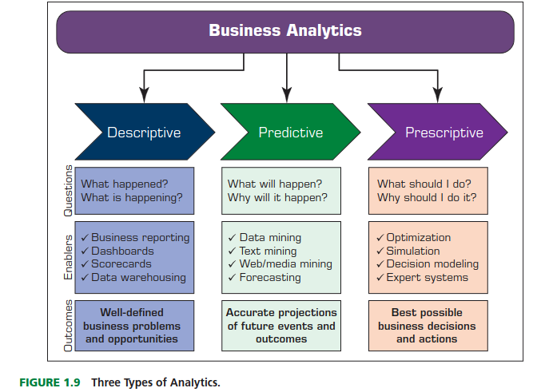
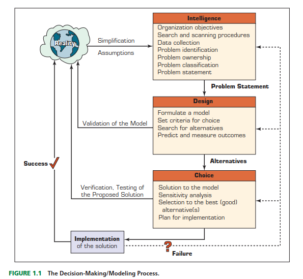
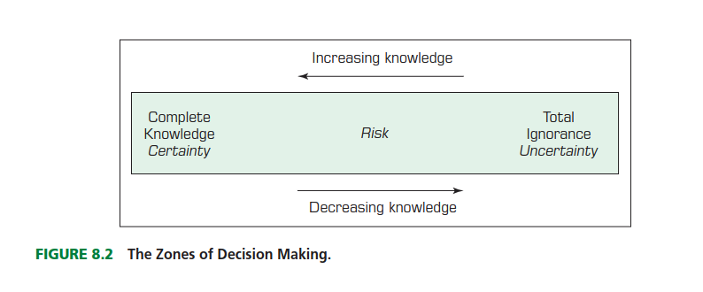
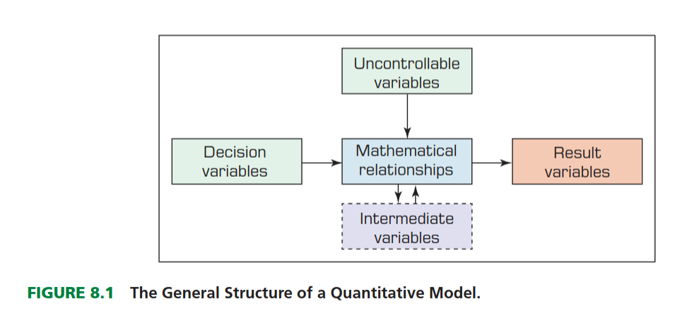

## Toma de decisiones en Business Intelligence



## Toma de decisión y soporte en datos

::: {.callout-important}

La toma de decisiones es un proceso de elección **entre dos o más cursos de acción alternativos** con el fin de alcanzar uno o más objetivos. 
:::

- Según Simon (1977), la toma de decisiones gerenciales es sinónimo de todo el proceso de gestión. Consideremos la importante función gerencial de la planificación. 

- La planificación implica una serie de decisiones: ¿Qué se debe hacer? ¿Cuándo? ¿Dónde? ¿Por qué? ¿Cómo? ¿Quién debe hacerlo? 

- Los gerentes establecen objetivos, es decir, planifican; por lo tanto, la planificación implica la toma de decisiones. Otras funciones gerenciales, como la organización y el control, también implican la toma de decisiones.

## El proceso de toma de decisiones



## El proceso de toma de decisiones

::: {.callout-important}

- La fase de selección de alternativas incluye la elección de una solución propuesta para el modelo (no necesariamente para el problema que representa). Esta solución se prueba para determinar su viabilidad.

- Durante este proceso, es necesario predecir el resultado futuro de cada alternativa propuesta.

- Las decisiones las tomamos bajo:
    - Certeza
    - Riesgo
    - Incertidumbre

:::

## Espacio de toma de decisiones según el conocimiento



## Espacio de toma de decisiones según el conocimiento

- En la toma de decisiones **bajo certeza**, se asume que se dispone de información completa, de modo que quien toma la decisión sabe con exactitud cuál será el resultado de cada curso de acción (como en un entorno determinista).

- Una **decisión tomada bajo riesgo** es aquella en la que quien toma la decisión debe considerar varios resultados posibles para cada alternativa, y **conoce o puede estimar la probabilidad** de que ocurra cada uno.

- En la toma de decisiones en **condiciones de incertidumbre**, también son posibles varios resultados para cada curso de acción, pero quien toma la decisión **no conoce ni puede estimar sus probabilidades**.

# Análisis Cuantitativo {background-color="#790cee"}

## Modelar la toma de decisiones



## Modelar la toma de decisiones

- Un modelo matemático es una **representación simplificada** de la realidad que utiliza el lenguaje, los símbolos y las estructuras de las matemáticas para describir, explicar o predecir el comportamiento de un sistema.

- Los modelos sirven para:
    - **Optimizar:** encontrar la mejor forma de asignar recursos.
    - **Predecir:** anticipar escenarios futuros bajo condiciones específicas.
    - **Controlar:** entender qué palancas mover para obtener un resultado deseado.


## Evaluación de alternativas

Para evaluar con rigor distintas alternativas de acción en BI, es fundamental integrar:

1.  **Rigor Estadístico:** Mediante simulaciones.
2.  **Flexibilidad:** Incorporando criterios cualitativos.
3.  **Robustez:** Entendiendo el impacto de la incertidumbre.

## El Modelado de la incertidumbre

El núcleo de la evaluación reside en entender cómo varían los **KPIs** ante cambios en los supuestos de entrada.

- **Análisis de sensibilidad:** Identifica qué variables generan mayor variación de los indicadores clave. Se debe definir valores mínimos y máximos como supuestos o escenarios.
- **Simulación de Monte Carlo:** Genera rangos de probabilidad en lugar de números estáticos. Útil para ver en términos de probabilidad todos los escenarios posibles.

## Análisis de sensibilidad (Tornado)

- Un gráfico tornado es una representación visual que muestra el impacto de múltiples variables independientes en una variable dependiente. 
- Se utiliza principalmente en análisis de sensibilidad, permitiendo identificar cuáles variables tienen el mayor impacto en el resultado final. 

- **Análisis unidireccional:** variar una sola variable (por ejemplo, el precio o el costo) manteniendo las demás constantes en su valor base.
- **Diagrama de tornado:** ordena las variables según su impacto en el resultado final; la de mayor impacto queda arriba.

## Tornado: Ejemplo de Análisis de Sensibilidad

- **Variable 1: Precio de venta**
    - Rango: $100 - $150
- **Variable 2: Costo de producción**
    - Rango: $50 - $80
- **Variable 3: Volumen de ventas**
    - Rango: 1000 - 1500 unidades
- **Resultado:** Impacto en la utilidad neta

## Gráfico Tornado en python

```{python}
import matplotlib.pyplot as plt
import pandas as pd


# 1. Modelo: utilidad neta
def calcular_utilidad(precio, costo, volumen):
    return (precio - costo) * volumen


# Mostrar números con punto como separador de miles: 75000 -> "75.000"
def formato(x):
    return f"{x:,.0f}".replace(",", ".")


# 2. Escenario base: punto medio de cada rango
precio_base = 125
costo_base = 65
volumen_base = 1250
utilidad_base = calcular_utilidad(precio_base, costo_base, volumen_base)

# 3. Variar una variable a la vez, dejando las demás en su valor base.
#    Se calcula cuánto cambia la utilidad respecto al escenario base.
#    Ojo: para el costo, el escenario desfavorable es el costo MÁS ALTO (80).
tornado = pd.DataFrame(
    {
        "variable": ["Precio de venta", "Costo de producción", "Volumen de ventas"],
        "desfavorable": [
            calcular_utilidad(100, costo_base, volumen_base) - utilidad_base,
            calcular_utilidad(precio_base, 80, volumen_base) - utilidad_base,
            calcular_utilidad(precio_base, costo_base, 1000) - utilidad_base,
        ],
        "favorable": [
            calcular_utilidad(150, costo_base, volumen_base) - utilidad_base,
            calcular_utilidad(precio_base, 50, volumen_base) - utilidad_base,
            calcular_utilidad(precio_base, costo_base, 1500) - utilidad_base,
        ],
    }
)

# 4. Ordenar por el tamaño del impacto: la variable más importante queda arriba
tornado["rango"] = tornado["favorable"] - tornado["desfavorable"]
tornado = tornado.sort_values("rango")
print(tornado)

# 5. Gráfico
fig, ax = plt.subplots(figsize=(10, 5))
ax.barh(
    tornado["variable"],
    tornado["desfavorable"],
    color="salmon",
    label="Escenario desfavorable",
)
ax.barh(
    tornado["variable"],
    tornado["favorable"],
    color="skyblue",
    label="Escenario favorable",
)
ax.axvline(0, color="black", linestyle="--")
ax.set_title(
    f"Análisis de sensibilidad: impacto en la utilidad neta (base = {formato(utilidad_base)} $)"
)
ax.set_xlabel("Variación respecto a la utilidad base ($)")
ax.legend(loc="lower right")
plt.tight_layout()
plt.show()
```

- El **precio de venta** es la variable que más mueve la utilidad: es la primera que la gerencia debe vigilar.
- El tornado sale simétrico porque la utilidad cambia en línea recta con cada variable y el escenario base es el punto medio de cada rango.

## Simulación de Monte Carlo

::: {.callout-note}

La simulación de Monte Carlo es un tipo de algoritmo computacional que utiliza un **muestreo aleatorio repetido** para obtener la probabilidad de que ocurra una serie de resultados.

:::


::: {.columns}

::: {.column}


- El método fue desarrollado por **Stanislaw Ulam** y **John von Neumann** en el laboratorio de Los Álamos (1946-1947) para simular problemas físicos demasiado complejos para resolverlos con fórmulas.
- Su nombre, propuesto por Nicholas Metropolis, alude al famoso **casino de Monte Carlo, en Mónaco**, porque el azar es central en el método, como en un juego de ruleta.
- En otras palabras, una simulación de Monte Carlo construye un modelo de posibles resultados aprovechando una distribución de probabilidad para variables inciertas, y luego **ejecuta muchas iteraciones** del modelo para generar una distribución de resultados posibles.

:::

::: {.column}


:::

:::


## Comparación entre Análisis de Sensibilidad y Simulación de Monte Carlo

Si bien el análisis de sensibilidad nos ayuda a entender el impacto de cada variable de forma individual, la simulación de Monte Carlo nos permite ver cómo **interactúan todas las variables juntas**, proporcionando una visión más completa de la incertidumbre y el riesgo asociado a nuestras decisiones.


## Proceso de Simulación de Monte Carlo

- **Definir el modelo:** Identificar las variables clave y su relación con el resultado.
- **Asignar distribuciones de probabilidad:** Para cada variable incierta, asignar una distribución de probabilidad adecuada (normal, uniforme, triangular, etc.).
- **Ejecutar simulaciones:** Realizar miles o millones de iteraciones, muestreando aleatoriamente de las distribuciones asignadas.
- **Analizar resultados:** Obtener una distribución de resultados posibles, calcular métricas como la media, mediana, percentiles, y evaluar la probabilidad de alcanzar ciertos umbrales.

## Ejemplo de Simulación de Monte Carlo en Python

- Se usa el mismo modelo y los mismos rangos del tornado, pero ahora **todas las variables cambian al mismo tiempo**.
- Cada variable sigue una **distribución triangular**: mínimo, valor más probable (el escenario base) y máximo.
- La gerencia necesita una utilidad de al menos **70.000 $** para cubrir la inversión del proyecto. ¿Qué probabilidad hay de alcanzarla?

```{python}
import numpy as np

# 1. Modelo: se reutiliza calcular_utilidad() del tornado

# 2. Distribuciones de probabilidad: triangular(mínimo, más probable, máximo)
rng = np.random.default_rng(2026)  # semilla: los resultados son siempre los mismos
n = 10_000  # número de simulaciones

precio = rng.triangular(100, 125, 150, size=n)
costo = rng.triangular(50, 65, 80, size=n)
volumen = rng.triangular(1000, 1250, 1500, size=n)

# 3. Ejecutar la simulación: una utilidad por cada escenario simulado
utilidad = calcular_utilidad(precio, costo, volumen)

# 4. Analizar los resultados
meta = 70_000
utilidad_media = utilidad.mean()
p5, p95 = np.percentile(utilidad, [5, 95])
prob_meta = (utilidad >= meta).mean()

print(f"Utilidad media: {formato(utilidad_media)} $")
print(f"El 90 % de los escenarios está entre {formato(p5)} $ y {formato(p95)} $")
print(f"Probabilidad de alcanzar la meta de {formato(meta)} $: {prob_meta:.1%}")
print(f"Probabilidad de pérdida (utilidad < 0): {(utilidad < 0).mean():.1%}")

plt.figure(figsize=(10, 5))
plt.hist(utilidad, bins=50, color="skyblue", edgecolor="black")
plt.axvline(meta, color="red", linestyle="--", label=f"Meta: {formato(meta)} $")
plt.title("Simulación de Monte Carlo: distribución de la utilidad neta")
plt.xlabel("Utilidad neta ($)")
plt.ylabel("Frecuencia")
plt.legend()
plt.tight_layout()
plt.show()
```

## Interpretación de la simulación

- En lugar de un único número (la utilidad del escenario base, `{python} formato(utilidad_base)` $), la simulación entrega una **distribución de resultados posibles**.
- La utilidad media es de `{python} formato(utilidad_media)` $, y en el 90 % de los escenarios queda entre `{python} formato(p5)` $ y `{python} formato(p95)` $.
- La probabilidad de alcanzar la meta de 70.000 $ es de `{python} f"{prob_meta:.0%}"`: aunque el escenario base supera la meta, en cerca de **4 de cada 10 escenarios** no se alcanza.
- La probabilidad de pérdida es **cero**: incluso en el peor caso (precio 100, costo 80 y volumen 1.000) la utilidad es positiva.

::: {.callout-important}

La decisión ya no depende solo de "¿cuánto ganaremos?", sino de **"¿qué riesgo estamos dispuestos a asumir?"**. Si para la gerencia un 40 % de probabilidad de no cubrir la inversión es demasiado, el tornado indica dónde actuar primero: **asegurar el precio de venta**.

:::

## Conclusiones

- Evaluar alternativas en BI exige **modelar** cómo los supuestos de entrada afectan los KPIs.
- El **análisis de sensibilidad (tornado)** muestra qué variable pesa más, cambiando una a la vez.
- La **simulación de Monte Carlo** combina la incertidumbre de todas las variables y responde preguntas en términos de **probabilidad**.
- Ambas herramientas se complementan: el tornado dice **dónde mirar** y Monte Carlo dice **qué tan probable** es cada resultado.