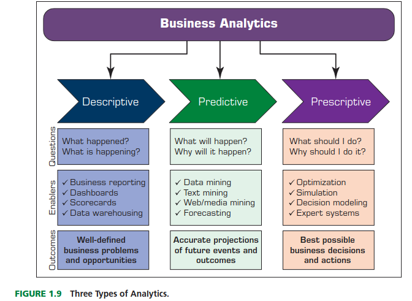
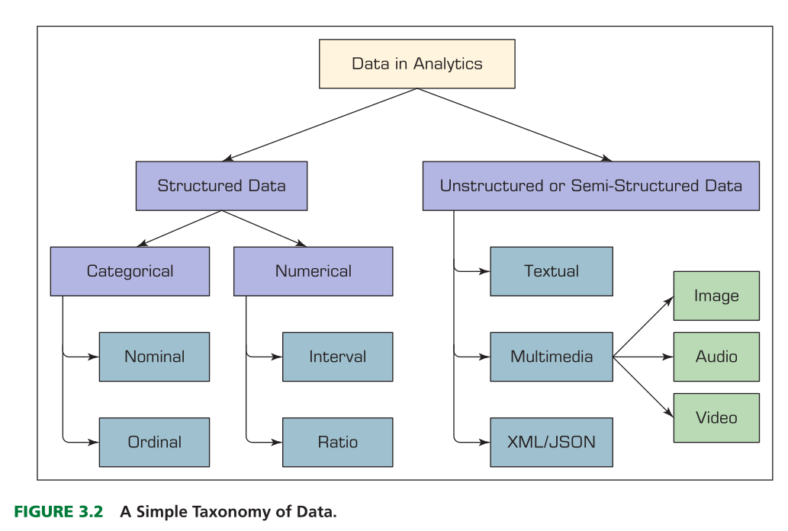
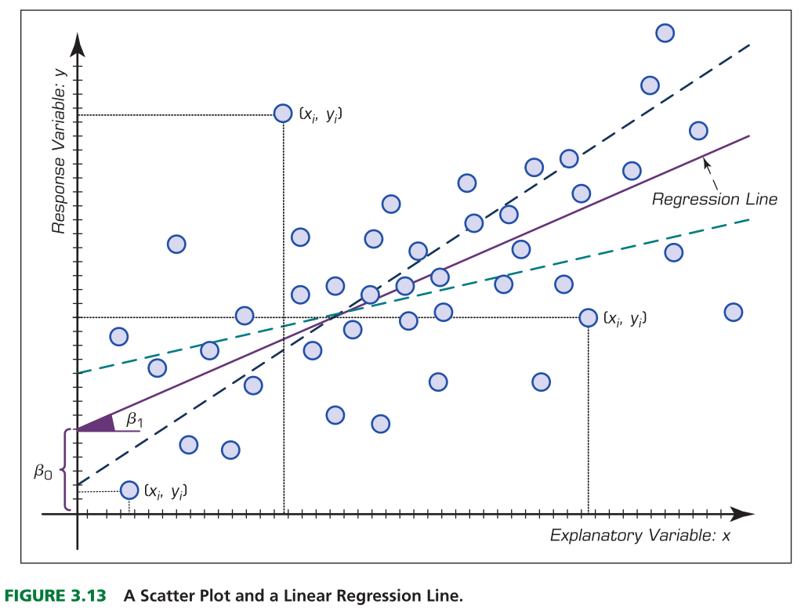

## Toma de decisiones en Business Intelligence



## Tipo de datos



## Modelación estadística en Business Intelligence

- La estadística suele considerarse parte de la analítica descriptiva. 
- Existe dos enfoques : estadística descriptiva y la inferencial
- La estadística descriptiva se centra en **describir los datos** de la muestra disponible, la estadística inferencial se ocupa de **extraer inferencias o conclusiones** sobre las características de la población.
- Algunos de los métodos estadísticos también pueden considerarse parte de la **analítica predictiva**, como el análisis discriminante, la **regresión** múltiple, la regresión logística y el agrupamiento k-means.

## Regresión

- La regresión, especialmente la regresión lineal, es quizá la técnica analítica más conocida y utilizada en estadística. 

- La regresión es una técnica estadística utilizada para caracterizar las **relaciones entre la(s) variable(s) explicativa(s) o independiente(s) (de entrada) y la(s) variable(s) de respuesta o dependiente(s) (de salida)**.

$$
Y = \beta_1 + \beta_2 X
$$

## Esquema de la regresión



## Uso de la regresión

- La regresión puede utilizarse con uno de dos propósitos: la **contrastación de hipótesis**, es decir, la investigación de posibles relaciones entre diferentes variables; y la **predicción o pronóstico**, 

- Es decir, la **estimación de los valores de una variable de respuesta a partir de una o más variables explicativas.** Estos dos usos no son mutuamente excluyentes. El poder explicativo de la regresión constituye también la base de su capacidad predictiva.

- En la predicción, la regresión identifica relaciones matemáticas aditivas (en forma de ecuación) entre una o más variables explicativas y una variable de respuesta.

$$
\hat{Y} = \hat{\beta_1} + \hat{\beta_2} X_{1} + \dots \hat{\beta_k}X_{K} + \varepsilon \\
\varepsilon = Y - \hat{Y}
$$

## Caso de estudio 1. Estimación y pronóstico de la demanda

- Usted es el analista de precios de una tienda de electrónica con ventas en tiendas físicas y online a nivel internacional. La gerencia desea ajustar los precios de los cinco productos estrella según la participación en los ingresos de ventas para el próximo trimestre, pero no saben el efecto en la ventas.

- Usando la base histórica de ventas entre 2016-2023 y utilizando el concepto de **Elasticidad Precio de la Demanda**


- La elasticidad precio de la demanda revela cuánto varia la cantidad demandada de un bien o servicio frente a los cambios en su precio :

$$
E_p = \frac{\%\Delta Q}{\%\Delta P} = \frac{\Delta Q / Q}{\Delta P / P} = \frac{\Delta Q}{\Delta P} \cdot \frac{P}{Q}
$$
- Si la elasticidad precio (Ep) es $<0$ quiere decir refleja la **Ley de la Demanda :** existe una relación inversa entre el precio y la cantidad demandada. Si el precio sube, la demanda baja, y viceversa.

- La regresión serí así :

$$
Q = \beta_1 + \beta_2 P + \varepsilon
$$
- Los modelos de elasticidad log-log son un tipo de modelo econométrico comúnmente utilizado para estimar elasticidades, incluida la elasticidad-precio de la demanda.

$$
\ln(Q) = \beta_1 + \beta_2 \ln(P) + \varepsilon \\
E_p = \frac{\partial \ln(Q)}{\partial \ln(P)} = \beta_2
$$

- Por ejemplo, $\beta_2 = −1.5$ quiere decir que si el precio sube 1%, la cantidad baja alrededor de 1.5 %.

# Modelos de clasificación {background-color="#790cee"}

## Modelos de clasificación

::: {.callout-important}

Un modelo de clasificación predice **a qué categoría pertenece** una observación. A diferencia de la regresión lineal, la variable de respuesta $Y$ es **cualitativa** (sí/no, fuga/permanece, fraude/legítimo).

:::

- En regresión preguntamos **¿cuánto?** (ventas, demanda, precio); en clasificación preguntamos **¿cuál?** o **¿ocurrirá?**
- La mayoría de los modelos no entregan directamente la clase, sino una **probabilidad** $P(Y = 1 \mid X)$. La decisión final se toma comparando esa probabilidad con un **umbral**.
- Aplicaciones típicas en Business Intelligence:
    - **Fuga de clientes (churn):** ¿qué clientes cancelarán su suscripción?
    - **Riesgo crediticio:** ¿qué solicitante incumplirá el pago?
    - **Detección de fraude:** ¿qué transacción es fraudulenta?
    - **Marketing:** ¿qué cliente responderá a una campaña?

Veremos tres modelos: **regresión logística (logit)**, **árbol de clasificación** y **random forest**, y cómo evaluarlos con **estadísticos de rendimiento**.

## Caso de estudio 2. Fuga de clientes (churn)

- Usted es analista de BI de una empresa de telecomunicaciones. Cada mes, una parte de los clientes cancela el servicio y la gerencia quiere lanzar una **campaña de retención** (descuento u oferta) antes de que se vayan.

- La campaña tiene un costo por cliente contactado, por lo que **no es rentable ofrecerla a todos**. La pregunta de negocio es:

::: {.callout-note}

**¿A qué clientes debemos dirigir la campaña de retención?**

:::

- Disponemos de una base histórica de 5.000 clientes con las variables:

| Variable | Descripción |
|---|---|
| `antiguedad` | Meses como cliente |
| `cargo_mensual` | Valor de la factura mensual (USD) |
| `contrato` | Tipo de contrato: Mensual, Anual, Bianual |
| `llamadas_soporte` | Número de llamadas a soporte técnico en el último trimestre |
| `pago_electronico` | 1 si paga con cheque electrónico, 0 en otro caso |
| `churn` | **Variable objetivo:** 1 si el cliente se fue, 0 si permanece |

## Datos del caso en python

```{python}
import numpy as np
import pandas as pd

# Datos simulados de clientes de una empresa de telecomunicaciones
# (generados con simular_datos.R)
df = pd.read_csv("datos/telco_churn.csv")

print(df.head())
print(f"\nTasa de fuga: {df['churn'].mean():.1%}")
df.groupby("contrato")["churn"].mean().sort_values()
```

## Entrenamiento y prueba

::: {.callout-important}

Un modelo se evalúa con datos que **no vio durante la estimación**. Si lo evaluamos con los mismos datos de entrenamiento, sobreestimamos su capacidad predictiva (**sobreajuste** u *overfitting*).

:::

- **Conjunto de entrenamiento (70 %):** se usa para estimar los parámetros del modelo.
- **Conjunto de prueba (30 %):** se usa solo para medir el rendimiento.
- La partición se hace **estratificada**, para conservar la misma proporción de clientes que se fugan en ambos conjuntos. En los datos viene definida en la columna `conjunto`; desde cero se haría con `train_test_split(X, y, test_size=0.3, stratify=y)`.

```{python}
predictores = ["antiguedad", "cargo_mensual", "contrato", "llamadas_soporte", "pago_electronico"]
X = pd.get_dummies(df[predictores], columns=["contrato"], dtype=int)
X = X.drop(columns="contrato_Mensual")  # categoría base
y = df["churn"]

entrenamiento = df["conjunto"] == "entrenamiento"
X_train, X_test = X[entrenamiento], X[~entrenamiento]
y_train, y_test = y[entrenamiento], y[~entrenamiento]

print(
    f"Entrenamiento: {X_train.shape[0]} clientes | Prueba: {X_test.shape[0]} clientes"
)
```

## Regresión logística (logit)

- Si usamos regresión lineal con $Y \in \{0, 1\}$, las predicciones pueden salir **menores que 0 o mayores que 1**, lo cual no tiene sentido como probabilidad.
- La regresión logística transforma la combinación lineal de variables mediante la **función sigmoide**, que siempre devuelve valores entre 0 y 1:

$$
P(Y = 1 \mid X) = \frac{1}{1 + e^{-(\beta_1 + \beta_2 X_2 + \dots + \beta_k X_k)}}
$$

- De forma equivalente, el modelo es lineal en el **logaritmo de los odds** (*log-odds* o *logit*):

$$
\ln\left(\frac{p}{1 - p}\right) = \beta_1 + \beta_2 X_2 + \dots + \beta_k X_k
$$

- Los parámetros se estiman por **máxima verosimilitud**, no por mínimos cuadrados.

```{python}
import matplotlib.pyplot as plt

z_grid = np.linspace(-6, 6, 200)
plt.figure(figsize=(8, 4))
plt.plot(z_grid, 1 / (1 + np.exp(-z_grid)), color="#790cee", linewidth=2)
plt.axhline(0.5, color="gray", linestyle="--", alpha=0.7)
plt.title("Función sigmoide", fontsize=14)
plt.xlabel(r"$\beta_1 + \beta_2 X_2 + \dots + \beta_k X_k$")
plt.ylabel("P(Y = 1)")
plt.tight_layout()
plt.show()
```

## Interpretación del logit

- El signo de $\beta_j$ indica la **dirección** del efecto: si $\beta_j > 0$, aumentar $X_j$ aumenta la probabilidad de fuga.
- La magnitud se interpreta mediante el **odds ratio** $e^{\beta_j}$:
    - $e^{\beta_j} > 1$: por cada unidad adicional de $X_j$, los *odds* de fuga se multiplican por $e^{\beta_j}$.
    - $e^{\beta_j} < 1$: los *odds* de fuga disminuyen.
- Por ejemplo, $e^{\beta_j} = 1.5$ en `llamadas_soporte` quiere decir que cada llamada adicional a soporte aumenta los *odds* de fuga en un 50 %.

::: {.callout-note}

Al igual que en la regresión lineal, el logit permite **contrastar hipótesis** sobre cada variable (estadístico $z$ y valor p), por lo que combina capacidad **explicativa** y **predictiva**.

:::

## Logit en python

```{python}
import statsmodels.api as sm

logit = sm.Logit(y_train, sm.add_constant(X_train)).fit(disp=False)
print(logit.summary())

# Odds ratios
odds_ratios = pd.DataFrame(
    {"Odds ratio": np.exp(logit.params), "Valor p": logit.pvalues}
).round(3)
odds_ratios
```

## Árbol de clasificación

::: {.callout-note}

Un árbol de clasificación divide los datos de forma **recursiva** en grupos cada vez más homogéneos, mediante preguntas del tipo **¿antigüedad < 12 meses?**

:::

- Cada **nodo interno** es una pregunta sobre una variable; cada **hoja** asigna una clase (o una probabilidad) a los clientes que llegan a ella.
- En cada paso, el algoritmo elige la variable y el punto de corte que más reducen la **impureza** de los grupos resultantes. La medida más usada es el **índice de Gini**:

$$
G = 1 - \sum_{k=1}^{K} p_k^2
$$

donde $p_k$ es la proporción de observaciones de la clase $k$ en el nodo. $G = 0$ indica un nodo puro.

- **Ventajas:** muy fácil de explicar a la gerencia, captura **no linealidades e interacciones** sin especificarlas.
- **Desventajas:** un árbol muy profundo **memoriza** los datos de entrenamiento (sobreajuste) y es inestable ante pequeños cambios en los datos. Por eso se limita su crecimiento (profundidad máxima, mínimo de observaciones por hoja).

## Árbol de clasificación en python

```{python}
from sklearn.tree import DecisionTreeClassifier, plot_tree

arbol = DecisionTreeClassifier(max_depth=3, min_samples_leaf=50, random_state=2026)
arbol.fit(X_train, y_train)

plt.figure(figsize=(16, 7))
plot_tree(
    arbol,
    feature_names=X_train.columns,
    class_names=["Permanece", "Fuga"],
    filled=True,
    rounded=True,
    proportion=True,
    fontsize=10,
)
plt.title("Árbol de clasificación: fuga de clientes", fontsize=14)
plt.show()
```

## Random forest

::: {.callout-important}

Un random forest (bosque aleatorio) combina **cientos de árboles** de clasificación y toma la decisión por **votación**: la probabilidad de fuga es la proporción de árboles que predicen fuga.

:::

- Cada árbol se entrena con una **muestra bootstrap** (muestreo con reemplazo) de los datos: esto se conoce como *bagging*.
- En cada división, el árbol solo puede elegir entre un **subconjunto aleatorio de variables**, lo que hace a los árboles distintos entre sí.
- Al promediar muchos árboles diferentes se **reduce la varianza**: el bosque es mucho más estable y preciso que un solo árbol.
- **Costo:** se pierde la interpretación directa del árbol individual (modelo de "caja negra"). Para recuperar parte de ella se usa la **importancia de variables**, que mide cuánto contribuye cada variable a reducir la impureza.

## Random forest en python

```{python}
from sklearn.ensemble import RandomForestClassifier

bosque = RandomForestClassifier(
    n_estimators=300, min_samples_leaf=20, random_state=2026, n_jobs=-1
)
bosque.fit(X_train, y_train)

importancia = pd.Series(
    bosque.feature_importances_, index=X_train.columns
).sort_values()

plt.figure(figsize=(9, 5))
plt.barh(importancia.index, importancia.values, color="skyblue", edgecolor="black")
plt.title("Random forest: importancia de las variables", fontsize=14)
plt.xlabel("Reducción media de la impureza (Gini)")
plt.tight_layout()
plt.show()
```

# Estadísticos de rendimiento {background-color="#790cee"}

## Matriz de confusión

- Para pasar de probabilidades a clases se fija un **umbral** (por defecto 0.5): si $\hat{p} \geq 0.5$ se predice fuga.
- La **matriz de confusión** cruza la clase real con la clase predicha:

| | **Predicho: Fuga (1)** | **Predicho: Permanece (0)** |
|---|---|---|
| **Real: Fuga (1)** | Verdadero Positivo (VP) | Falso Negativo (FN) |
| **Real: Permanece (0)** | Falso Positivo (FP) | Verdadero Negativo (VN) |

- En el caso de churn:
    - **FN:** un cliente que se va y **no** fue contactado → se pierde su ingreso futuro.
    - **FP:** un cliente que se iba a quedar y **sí** recibió la oferta → se gasta el costo de la campaña.

::: {.callout-note}

Los dos errores **no cuestan lo mismo**. Por eso la métrica a optimizar debe elegirse según el problema de negocio.

:::

## Métricas de clasificación

| Métrica | Fórmula | Pregunta que responde |
|---|---|---|
| **Exactitud** (*accuracy*) | $\frac{VP + VN}{VP + VN + FP + FN}$ | ¿Qué proporción de predicciones es correcta? |
| **Precisión** (*precision*) | $\frac{VP}{VP + FP}$ | De los que predije como fuga, ¿cuántos se fueron? |
| **Sensibilidad** (*recall*) | $\frac{VP}{VP + FN}$ | De los que se fueron, ¿cuántos detecté? |
| **Especificidad** | $\frac{VN}{VN + FP}$ | De los que se quedaron, ¿cuántos identifiqué bien? |
| **F1** | $2 \cdot \frac{\text{Precisión} \cdot \text{Sensibilidad}}{\text{Precisión} + \text{Sensibilidad}}$ | Balance entre precisión y sensibilidad |

::: {.callout-important}

Con **clases desbalanceadas** la exactitud engaña: si solo el 20 % de los clientes se fuga, un modelo que predice "nadie se va" tiene una exactitud del 80 % y no sirve para nada.

:::

## Curva ROC y AUC

- Cada umbral produce un par distinto de sensibilidad y especificidad. La **curva ROC** grafica la sensibilidad (tasa de verdaderos positivos) frente a $1 - \text{especificidad}$ (tasa de falsos positivos) para **todos los umbrales posibles**.
- El **AUC** (*Area Under the Curve*) resume la curva en un número:
    - $AUC = 0.5$: el modelo no es mejor que lanzar una moneda.
    - $AUC = 1$: el modelo separa perfectamente ambas clases.
    - Se interpreta como la probabilidad de que el modelo asigne una probabilidad de fuga **mayor** a un cliente que se fuga que a uno que permanece.
- Ventaja: el AUC **no depende del umbral** elegido, por lo que es útil para comparar modelos.

## Comparación de modelos en python

```{python}
from sklearn.metrics import (
    accuracy_score,
    precision_score,
    recall_score,
    f1_score,
    roc_auc_score,
    roc_curve,
    ConfusionMatrixDisplay,
)

# Probabilidades de fuga en el conjunto de prueba
probabilidades = {
    "Logit": logit.predict(sm.add_constant(X_test)),
    "Árbol": arbol.predict_proba(X_test)[:, 1],
    "Random forest": bosque.predict_proba(X_test)[:, 1],
}

metricas = []
for modelo, p in probabilidades.items():
    pred = (p >= 0.5).astype(int)
    metricas.append(
        {
            "Modelo": modelo,
            "Exactitud": accuracy_score(y_test, pred),
            "Precisión": precision_score(y_test, pred),
            "Sensibilidad": recall_score(y_test, pred),
            "F1": f1_score(y_test, pred),
            "AUC": roc_auc_score(y_test, p),
        }
    )

pd.DataFrame(metricas).set_index("Modelo").round(3)
```

::: {.callout-note}

- Un modelo más complejo **no siempre predice mejor**. Aquí el logit obtiene un AUC similar o superior al random forest porque la relación entre las variables y el *log-odds* de fuga es casi lineal.
- Con el umbral de 0.5 la **sensibilidad es baja**: los modelos detectan menos de la mitad de los clientes que se van. Esto motiva revisar el umbral.

:::

## Matriz de confusión y curva ROC en python

```{python}
fig, axes = plt.subplots(1, 2, figsize=(14, 6))

# Matriz de confusión del logit (umbral 0.5)
ConfusionMatrixDisplay.from_predictions(
    y_test,
    (probabilidades["Logit"] >= 0.5).astype(int),
    display_labels=["Permanece", "Fuga"],
    cmap="Blues",
    colorbar=False,
    ax=axes[0],
)
axes[0].set_title("Matriz de confusión: logit", fontsize=14)
axes[0].set_xlabel("Predicho")
axes[0].set_ylabel("Real")

# Curvas ROC de los tres modelos
for modelo, p in probabilidades.items():
    fpr, tpr, _ = roc_curve(y_test, p)
    axes[1].plot(fpr, tpr, label=f"{modelo} (AUC = {roc_auc_score(y_test, p):.3f})")
axes[1].plot([0, 1], [0, 1], color="gray", linestyle="--", label="Azar (AUC = 0.5)")
axes[1].set_title("Curva ROC", fontsize=14)
axes[1].set_xlabel("Tasa de falsos positivos (1 - especificidad)")
axes[1].set_ylabel("Tasa de verdaderos positivos (sensibilidad)")
axes[1].legend()

plt.tight_layout()
plt.show()
```


## ¿Qué modelo elegir?

| Criterio | Logit | Árbol de clasificación | Random forest |
|---|---|---|---|
| **Interpretabilidad** | Alta (odds ratios, valores p) | Muy alta (reglas de decisión) | Baja (importancia de variables) |
| **No linealidades e interacciones** | Hay que especificarlas | Las captura automáticamente | Las captura automáticamente |
| **Riesgo de sobreajuste** | Bajo | Alto | Bajo |
| **Capacidad predictiva** | Media | Media - baja | Alta |
| **Uso típico en BI** | Explicar factores de riesgo | Comunicar reglas a la gerencia | Maximizar la precisión de las predicciones |

::: {.callout-important}

No existe un modelo mejor en todos los casos. La elección depende del objetivo: **explicar** (¿por qué se van los clientes?) o **predecir** (¿quién se va a ir?), y del **costo de los errores** para el negocio.

:::

## Elegir el umbral

- El umbral de 0.5 es arbitrario. En BI el umbral debe elegirse según el **valor económico** de cada tipo de acierto y error.
- Supuestos de la campaña de retención:
    - Costo de contactar a un cliente con la oferta: **USD 20**.
    - Valor de retener a un cliente que se iba a fugar: **USD 100** (ingreso futuro esperado × tasa de éxito de la oferta).

$$
\text{Beneficio}(u) = 100 \cdot VP(u) - 20 \cdot \left[VP(u) + FP(u)\right]
$$

```{python}
umbrales = np.linspace(0.05, 0.95, 91)
p_logit = probabilidades["Logit"]

beneficio = []
for u in umbrales:
    contactados = p_logit >= u
    vp = (contactados & (y_test == 1)).sum()
    beneficio.append(100 * vp - 20 * contactados.sum())

beneficio = np.array(beneficio)
u_optimo = umbrales[beneficio.argmax()]

plt.figure(figsize=(9, 5))
plt.plot(umbrales, beneficio, color="#790cee", linewidth=2)
plt.axvline(
    u_optimo, color="red", linestyle="--", label=f"Umbral óptimo = {u_optimo:.2f}"
)
plt.axvline(0.5, color="gray", linestyle=":", label="Umbral por defecto = 0.50")
plt.title("Beneficio de la campaña según el umbral de decisión", fontsize=14)
plt.xlabel("Umbral de probabilidad de fuga")
plt.ylabel("Beneficio neto (USD)")
plt.legend()
plt.tight_layout()
plt.show()

print(f"Beneficio con umbral 0.50: USD {beneficio[np.isclose(umbrales, 0.5)][0]:,.0f}")
print(f"Beneficio con umbral óptimo ({u_optimo:.2f}): USD {beneficio.max():,.0f}")
```

# Agrupamiento k-means {background-color="#790cee"}

## Agrupamiento (clustering)

::: {.callout-important}

El agrupamiento es una técnica de **aprendizaje no supervisado**: no existe una variable de respuesta $Y$ que predecir. El objetivo es descubrir **grupos naturales** de observaciones que se parecen entre sí y se diferencian de los demás grupos.

:::

- En regresión y clasificación conocemos la respuesta en los datos históricos (ventas, fuga). En agrupamiento **nadie etiquetó los datos**: los grupos los encuentra el algoritmo.
- Aplicaciones típicas en Business Intelligence:
    - **Segmentación de clientes:** diseñar ofertas y comunicaciones diferenciadas.
    - **Segmentación de productos:** agrupar referencias por patrón de ventas para planear inventario.
    - **Segmentación geográfica:** agrupar tiendas o regiones con comportamiento similar.
    - **Detección de anomalías:** observaciones lejanas a todos los grupos.

## El algoritmo k-means

- k-means divide las $n$ observaciones en $k$ grupos, donde **cada grupo se representa por su centroide** (el promedio de sus observaciones).
- El algoritmo busca minimizar la **inercia** o suma de cuadrados dentro de los grupos (*WCSS*):

$$
WCSS = \sum_{j=1}^{k} \sum_{x_i \in C_j} \lVert x_i - \mu_j \rVert^2
$$

donde $\mu_j$ es el centroide del grupo $C_j$ y $\lVert \cdot \rVert$ es la distancia euclidiana.

**Pasos del algoritmo:**

1. Elegir el número de grupos $k$ y ubicar $k$ centroides iniciales.
2. **Asignar** cada observación al centroide más cercano.
3. **Actualizar** cada centroide como el promedio de las observaciones asignadas.
4. Repetir los pasos 2 y 3 hasta que las asignaciones no cambien.

## Consideraciones prácticas

- **Estandarizar las variables:** k-means usa distancias, por lo que una variable medida en miles (ingresos) domina a una medida en unidades (número de compras). Se transforma cada variable a media 0 y desviación 1:

$$
z = \frac{x - \bar{x}}{s}
$$

- **Inicialización:** el resultado depende de los centroides iniciales. Se usa la inicialización *k-means++* y se ejecuta el algoritmo varias veces (`n_init`), conservando la mejor solución.
- **Elegir $k$:** el analista debe definirlo. Dos criterios comunes:
    - **Método del codo:** graficar la inercia para distintos $k$ y buscar el punto donde deja de caer bruscamente.
    - **Coeficiente de silueta:** mide qué tan cerca está cada observación de su grupo frente al grupo vecino. Va de -1 a 1; valores altos indican grupos bien separados.
- **Limitaciones:** supone grupos de forma aproximadamente esférica y tamaño similar, es sensible a valores atípicos y solo funciona con variables numéricas.

::: {.callout-note}

El número de grupos también es una **decisión de negocio**: un $k$ estadísticamente óptimo no sirve si el área de marketing no puede diseñar y ejecutar una estrategia para cada segmento.

:::

## Caso de estudio 3. Segmentación de clientes (RFM)

- Usted es analista de BI de una cadena de retail. El área de marketing tiene un presupuesto limitado y quiere **dejar de enviar la misma promoción a todos los clientes**.

::: {.callout-note}

**¿Qué grupos de clientes existen y qué acción comercial conviene para cada uno?**

:::

- El análisis **RFM** es un enfoque clásico de segmentación basado en tres dimensiones del comportamiento de compra:

| Variable | Descripción |
|---|---|
| `recencia` | Días desde la última compra (menor es mejor) |
| `frecuencia` | Número de compras en el último año |
| `ticket_promedio` | Valor promedio de cada compra (USD) |

- Disponemos de 2.000 clientes con su historial de compras del último año.

## Datos del caso en python

```{python}
# Datos simulados de clientes de una cadena de retail
# (generados con simular_datos.R)
clientes = pd.read_csv("datos/retail_rfm.csv")

print(clientes.head())
clientes.drop(columns="id_cliente").describe().round(1)
```

## Elegir el número de grupos en python

```{python}
from sklearn.cluster import KMeans
from sklearn.metrics import silhouette_score
from sklearn.preprocessing import StandardScaler

variables_rfm = ["recencia", "frecuencia", "ticket_promedio"]
X_rfm = StandardScaler().fit_transform(clientes[variables_rfm])

k_valores = range(2, 9)
inercia, silueta = [], []
for k in k_valores:
    km = KMeans(n_clusters=k, n_init=10, random_state=2026).fit(X_rfm)
    inercia.append(km.inertia_)
    silueta.append(silhouette_score(X_rfm, km.labels_))

fig, axes = plt.subplots(1, 2, figsize=(14, 5))

axes[0].plot(k_valores, inercia, marker="o", color="#790cee", linewidth=2)
axes[0].set_title("Método del codo", fontsize=14)
axes[0].set_xlabel("Número de grupos (k)")
axes[0].set_ylabel("Inercia (WCSS)")

axes[1].plot(k_valores, silueta, marker="o", color="skyblue", linewidth=2)
axes[1].set_title("Coeficiente de silueta", fontsize=14)
axes[1].set_xlabel("Número de grupos (k)")
axes[1].set_ylabel("Silueta promedio")

plt.tight_layout()
plt.show()
```

## Estimación de k-means en python

```{python}
kmeans = KMeans(n_clusters=4, n_init=10, random_state=2026).fit(X_rfm)
clientes["grupo"] = kmeans.labels_

# Perfil de cada grupo en las unidades originales
perfil = clientes.groupby("grupo")[variables_rfm].mean()
perfil["clientes"] = clientes["grupo"].value_counts()
perfil["% clientes"] = perfil["clientes"] / perfil["clientes"].sum() * 100

# Nombrar los segmentos ordenándolos por recencia (de más a menos reciente)
nombres = ["Campeones", "Leales", "Ocasionales de alto ticket", "Inactivos"]
perfil = perfil.sort_values("recencia")
clientes["segmento"] = clientes["grupo"].map(dict(zip(perfil.index, nombres)))
perfil.index = nombres

perfil.round(1)
```

## Visualización de los segmentos

```{python}
colores = dict(zip(nombres, ["#790cee", "skyblue", "orange", "salmon"]))

fig, axes = plt.subplots(1, 2, figsize=(14, 6))
for segmento, grupo in clientes.groupby("segmento"):
    axes[0].scatter(grupo["recencia"], grupo["frecuencia"], s=12, alpha=0.6,
                    color=colores[segmento], label=segmento)
    axes[1].scatter(grupo["frecuencia"], grupo["ticket_promedio"], s=12, alpha=0.6,
                    color=colores[segmento], label=segmento)

axes[0].set_title("Recencia vs. frecuencia", fontsize=14)
axes[0].set_xlabel("Recencia (días)")
axes[0].set_ylabel("Frecuencia (compras al año)")
axes[1].set_title("Frecuencia vs. ticket promedio", fontsize=14)
axes[1].set_xlabel("Frecuencia (compras al año)")
axes[1].set_ylabel("Ticket promedio (USD)")
axes[1].legend()

plt.tight_layout()
plt.show()
```

## De los segmentos a la decisión

| Segmento | Perfil | Acción comercial sugerida |
|---|---|---|
| **Campeones** | Compran muy seguido, hace poco y con buen ticket | Programa de fidelización, acceso anticipado a lanzamientos, embajadores de marca |
| **Leales** | Compran con regularidad pero con ticket bajo | Venta cruzada (*cross-selling*) y venta adicional (*up-selling*) para subir el ticket |
| **Ocasionales de alto ticket** | Compran poco, pero cada compra es grande | Recordatorios personalizados y beneficios por recompra para aumentar la frecuencia |
| **Inactivos** | Llevan meses sin comprar, poca frecuencia y ticket bajo | Campaña de reactivación de bajo costo; si no responden, reducir inversión |

::: {.callout-important}

k-means también sirve para **predecir**: cuando llega un cliente nuevo, se estandarizan sus variables y se asigna al **centroide más cercano** (`kmeans.predict`), lo que permite activar automáticamente la estrategia de su segmento.

:::

## Resumen: modelos para la toma de decisiones en BI

| | Regresión | Clasificación | Agrupamiento |
|---|---|---|---|
| **Tipo de aprendizaje** | Supervisado | Supervisado | No supervisado |
| **Variable de respuesta** | Cuantitativa | Cualitativa | No existe |
| **Pregunta** | ¿Cuánto? | ¿Cuál? ¿Ocurrirá? | ¿Qué grupos existen? |
| **Modelos vistos** | Regresión lineal, log-log | Logit, árbol, random forest | k-means |
| **Evaluación** | $R^2$, error de pronóstico | Matriz de confusión, ROC, AUC | Inercia, silueta |
| **Decisión de negocio** | Fijar precios según la elasticidad | A quién dirigir la campaña de retención | Qué estrategia aplicar a cada segmento |