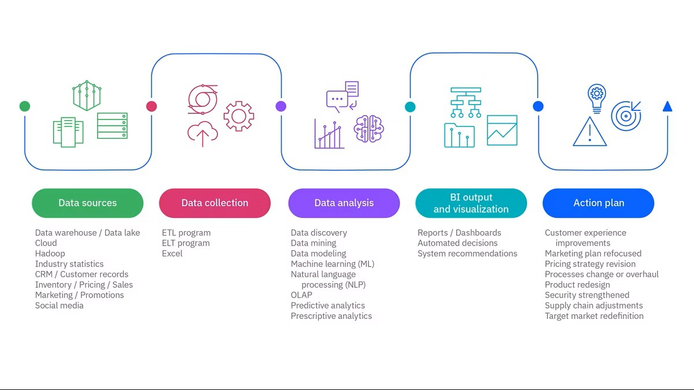
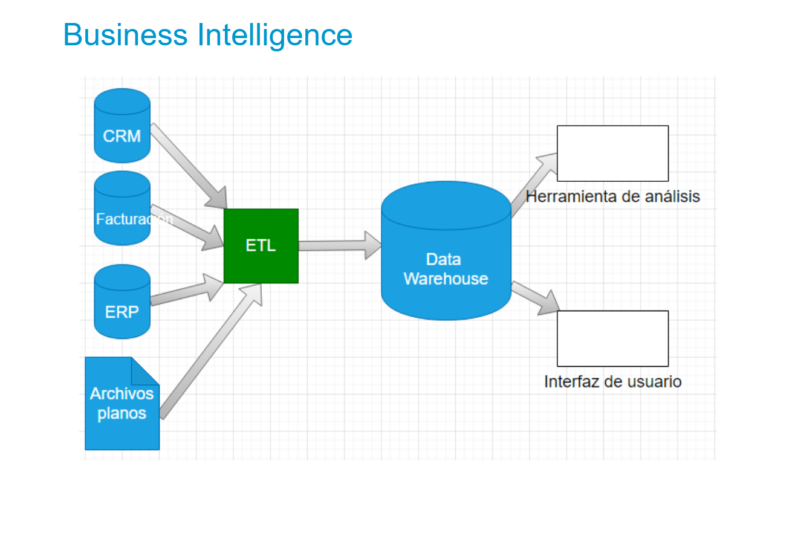
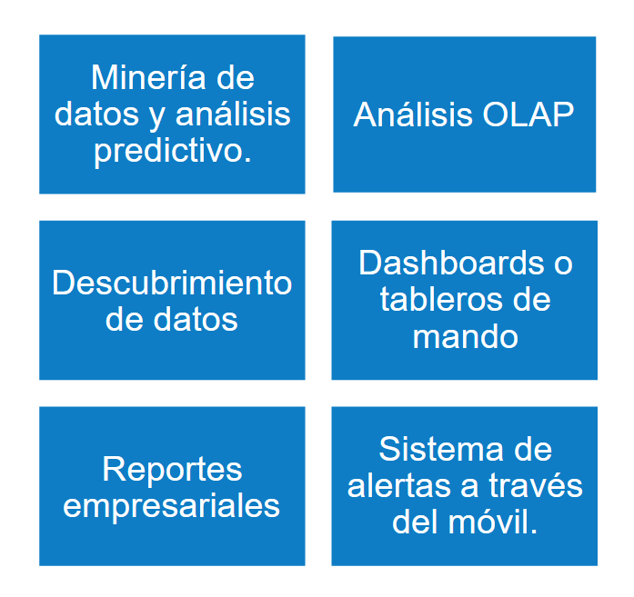
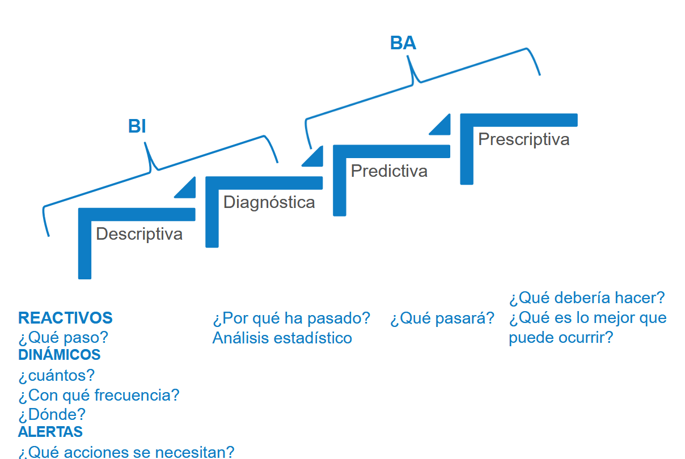

# Bienvenida {background-color="#1E2761"}

## Objetivos de la sesión

::: {.incremental}
- Comprender los conceptos fundamentales de Business Analytics
- Conocer la importancia de los datos en la toma de decisiones
- Concepto y técnicas de análisis exploratorio de datos (EDA)
:::

---

# Conceptos Básicos de Business Analytics {background-color="#1E2761"}

---

## ¿Qué es Business Analytics?

:::: {.columns}
::: {.column width="50%"}
**Definición:**
La analítica de negocio hace referencia a los métodos estadísticos y a las tecnologías informáticas para procesar, extraer y visualizar datos con el fin de descubrir patrones, relaciones y conocimientos que ayuden a tomar mejores decisiones empresariales.
:::

::: {.column width="50%"}
**Componentes clave:**

- Datos históricos
- Modelos estadísticos
- Técnicas de visualización
- Herramientas tecnológicas
- Interpretación de resultados
:::
::::


---

## Línea Temporal de la Evolución de la Inteligencia Empresarial (Business Intelligence)

::: {.fragment}
### 1865 – Primer uso del término “Inteligencia Empresarial”

Richard Millar Devens usa el término al describir a un banquero que obtenía información del mercado antes que sus competidores.
La idea clave: usar información como ventaja competitiva.
:::

::: {.fragment}
### 1958 – Primeros fundamentos tecnológicos de BI

Hans Peter Luhn, informático de IBM, explora el uso de tecnología para recopilar y analizar inteligencia empresarial.
Su investigación sienta las bases para los primeros sistemas de análisis de IBM.
:::

::: {.fragment}
### Años 60 – Aparición de sistemas de gestión de datos

Surgen los primeros sistemas de gestión de datos, necesarios para manejar el creciente volumen de información empresarial.
:::

::: {.fragment}
### Años 70 – Nacimiento de los Sistemas de Soporte a Decisiones (DSS)

Se crean los DSS, base del BI moderno.
Se desarrollan herramientas para acceder, organizar y analizar datos, incluyendo:

OLAP (procesamiento analítico en línea)
Sistemas de información ejecutiva (EIS)
Primeros almacenes de datos (data warehouses)
:::

::: {.fragment}
### Década de 1990 – Popularización de Business Intelligence

BI se expande en las empresas, pero la tecnología aún es compleja.
Los usuarios dependían del área de TI para generar informes, lo que causaba retrasos.
Incluso los analistas requerían formación extensa para consultar y analizar los datos correctamente.
:::
---

## Tipos de Analítica de Negocios

| Tipo | Pregunta | Objetivo | Ejemplo |
|------|----------|----------|---------|
| **Descriptiva** | ¿Qué pasó? | Entender el pasado | Ventas del último trimestre |
| **Diagnóstica** | ¿Por qué pasó? | Identificar causas | Caída en conversiones |
| **Predictiva** | ¿Qué pasará? | Anticipar eventos | Pronóstico de demanda |
| **Prescriptiva** | ¿Qué hacer? | Recomendar acciones | Optimización de precios |

---

## Importancia en la Toma de Decisiones

:::: {.columns}
::: {.column width="60%"}
### Beneficios Empresariales

1. **Decisiones basadas en evidencia** - Reducción de sesgos y suposiciones

2. **Ventaja competitiva** - Identificación de oportunidades antes que la competencia

3. **Eficiencia operativa** - Optimización de recursos y procesos

4. **Mejora continua** - Monitoreo y ajuste de estrategias en tiempo real
:::

::: {.column width="40%"}
### Impacto Medible

- +23% en precisión de pronósticos
- -15% en costos operativos
- +32% en satisfacción del cliente
- 50% más rápida la toma de decisiones

::: {.fragment .fade-in}
*Fuente: Estudios de McKinsey & Company, 2024*
:::
:::
::::

---

##  Cómo funciona la BI 



::: {.notes}
El ciclo de datos es continuo y retroalimentado. Los resultados generan nuevos datos que refinan futuras decisiones.
:::

---

## Casos de Uso Empresarial

:::: {.columns}
::: {.column width="33%"}
### Marketing
- Segmentación de clientes
- Análisis de ROI
- Personalización de campañas
- Predicción de churn
:::

::: {.column width="33%"}
### Operaciones
- Gestión de inventario
- Optimización logística
- Control de calidad
- Mantenimiento predictivo
:::

::: {.column width="33%"}
### Finanzas
- Análisis de riesgo
- Detección de fraude
- Pronóstico financiero
- Optimización de precios
:::
::::

---

# Proceso de Análisis de Datos {background-color="#1E2761"}

---

## El Ciclo Completo del Análisis

```{mermaid}
%%| fig-width: 11
%%| fig-height: 6
flowchart TD
    A[Definición del Problema] --> B[Recopilación de Datos]
    B --> C[Limpieza de Datos]
    C --> D[Análisis Exploratorio EDA]
    D --> E[Modelado y Análisis]
    E --> F[Visualización]
    F --> G[Interpretación y Comunicación]
    G --> H[Implementación]
    H --> I{¿Resultado satisfactorio?}
    I -->|No| A
    I -->|Sí| J[Monitoreo Continuo]

```

## El camino a la madurez analítica → Data Warehouse Institute (TDWI)

:::: {.columns}
::: {.column width="30%"}
- Organización
- Analítica
- Gobierno
- Data Management: Datos maestros, diccionario de datos.
- Infraestructura
:::

::: {.column width="70%"}

:::
::::

---

## Estilos de Bi



---

## Tipos de análisis Bi



---

## 1. Definición del Problema

:::: {.columns}
::: {.column width="45%"}
### Preguntas Clave

- ¿Qué decisión necesitamos tomar?
- ¿Qué pregunta queremos responder?
- ¿Cuál es el objetivo del análisis?
- ¿Qué métricas definirán el éxito?
:::

::: {.column width="55%"}
### Framework SMART

- ***objetivo medible + plazo + método/foco**

| Criterio | Descripción |
|----------|-------------|
| **S**pecific | Objetivo específico y claro. |
| **M**easurable | Medible con métricas concretas. Tiene un porcentaje o número claro (15%, 10%, 3%). |
| **A**chievable | Alcanzable con recursos disponibles. Se plantea una acción concreta (optimizar rutas, ajustar beneficios). |
| **R**elevant | Relevante para el negocio. Impacta directamente en el negocio. |
| **T**ime-bound | Con plazo definido. Tiene un límite claro (trimestre, semestre, año fiscal). |
:::
::::

::: {.callout-tip}
## Ejemplo
**Problema mal definido:** "Mejorar las ventas"  
**Problema bien definido:** 
    - Sector logística y operaciones : "Reducir el costo operativo de la última milla en un 10% antes del cierre del año fiscal, mediante la optimización de rutas basada en datos de tráfico en tiempo real y la consolidación de entregas por zona geográfica."
    - Sector SaaS (Suscripciones) : "Reducir la tasa de cancelación (churn rate) de usuarios premium del 5% al 3% durante el presente semestre, implementando un sistema de alertas preventivas basado en la caída de la frecuencia de uso de la plataforma."
:::

---

## 2. Recopilación de Datos

### Fuentes de Datos

:::: {.columns}
::: {.column width="50%"}
**Internas:**
- Sistemas CRM
- ERP empresarial
- Bases de datos transaccionales
- Logs de aplicaciones
- Encuestas internas
- Data warehouses
:::

::: {.column width="50%"}
**Externas:**
- Redes sociales
- APIs públicas
- Proveedores de datos
- Investigación de mercado
- Datos gubernamentales
- Web scraping
:::
::::

### Consideraciones Importantes

- **Calidad** sobre cantidad
- **Relevancia** para el problema
- **Actualización** y frecuencia
- **Cumplimiento** legal y ético (GDPR, protección de datos)

---

## 3. Limpieza de Datos

### Problemas Comunes

| Problema | Descripción | Solución |
|----------|-------------|----------|
| Valores faltantes | NaN, NULL, vacíos | Imputación, eliminación |
| Duplicados | Registros repetidos | Deduplicación |
| Inconsistencias | Formatos diferentes | Estandarización |
| Outliers | Valores atípicos | Análisis y tratamiento |
| Errores tipográficos | Datos mal ingresados | Validación y corrección |


---

## Calidad de Datos: Antes y Después

:::: {.columns}
::: {.column width="50%"}
### Antes de la Limpieza

| ID | Nombre    | Edad | Ciudad      |
|----|-----------|------|-------------|
| 1  | Juan      | 25   | bogota      |
| 2  | María     | NaN  | BOGOTA      |
| 1  | Juan      | 25   | bogota      |
| 3  | NULL      | -5   | Medellín    |
| 4  | Pedro     | 30   |             |


- Problemas detectados:
    - Duplicados
    - Valores faltantes
    - Inconsistencias de formato
    - Valores inválidos
:::

::: {.column width="50%"}
### Después de la Limpieza

| ID | Nombre    | Edad | Ciudad      |
|----|-----------|------|-------------|
| 1  | Juan      | 25   | Bogotá      |
| 2  | María     | 28   | Bogotá      |
| 4  | Pedro     | 30   | No especif. |


- Mejoras aplicadas:
    - Sin duplicados
    - Valores imputados
    - Formato estandarizado
    - Datos validados
:::
::::

---

## 4. Análisis Exploratorio de Datos (EDA)

### ¿Qué es EDA?

::: {.callout-note icon=false}
## Definición
El Análisis Exploratorio de Datos es el proceso de investigación inicial de los datos mediante estadísticas descriptivas y visualizaciones para descubrir patrones, detectar anomalías, verificar supuestos y generar hipótesis.
:::

### Objetivos Principales

1. **Entender la estructura** de los datos
2. **Identificar relaciones** entre variables
3. **Detectar patrones y tendencias**
4. **Descubrir anomalías** y valores atípicos
5. **Formular hipótesis** para análisis posteriores

---

## Técnicas de EDA: Visualizaciones Clave

:::: {.columns}
::: {.column width="50%"}
### Distribuciones
- **Histogramas** - Frecuencia de valores
- **Box plots** - Identificar outliers
- **Density plots** - Distribución suavizada

### Relaciones
- **Scatter plots** - Correlaciones
- **Heatmaps** - Matrices de correlación
- **Pair plots** - Múltiples variables
:::

::: {.column width="50%"}
### Tendencias
- **Gráficos de línea** - Series temporales
- **Bar charts** - Comparaciones
- **Stacked areas** - Composición

### Composición
- **Pie charts** - Proporciones simples
- **Treemaps** - Jerarquías
- **Sunburst** - Categorías anidadas
:::
::::

## Insights del EDA: Qué Buscar

::: {.panel-tabset}

### Patrones
- **Tendencias temporales**: ¿Los datos muestran estacionalidad?
- **Segmentación natural**: ¿Existen grupos diferenciados?
- **Relaciones no lineales**: ¿Las correlaciones son complejas?

### Anomalías
- **Outliers**: Valores extremos que requieren investigación
- **Gaps en datos**: Períodos sin información
- **Cambios abruptos**: Puntos de inflexión significativos

### Calidad
- **Distribuciones sesgadas**: Necesidad de transformaciones
- **Multicolinealidad**: Variables altamente correlacionadas
- **Missing patterns**: Patrones en datos faltantes

:::

---

## Herramientas del Ecosistema

| Categoría | Herramientas | Uso Principal |
|-----------|--------------|---------------|
| **Programación** | Python, R, SQL | Análisis y modelado |
| **Visualización** | Tableau, Power BI, D3.js | Dashboards e informes |
| **Big Data** | Spark, Hadoop, Databricks | Procesamiento masivo |
| **Cloud** | AWS, Azure, GCP | Infraestructura y escalabilidad |

---

## Ejercicio de BI: World Happiness Index

El **World Happiness Report** es una publicación anual que clasifica a los países según su nivel de felicidad basándose en datos de la encuesta Gallup World Poll.

**Definición del problema de negocio***

Eres analista de BI en una **consultora internacional** que asesora a gobiernos y organizaciones sobre políticas públicas para mejorar el bienestar ciudadano. Tu equipo ha sido contratado por tres clientes diferentes:

1. **Ministerio de Protección Social de Colombia** - Quiere identificar qué factores priorizar para mejorar el bienestar de Colombia
2. **Banco Mundial** - Busca países con alto potencial de inversión basándose en estabilidad y felicidad
3. **Organización de las Naciones Unidas** - Necesita identificar países que requieren intervención urgente

Formular **3 preguntas de negocio SMART** (una para cada cliente) que puedan responderse con el dataset del World Happiness Index.