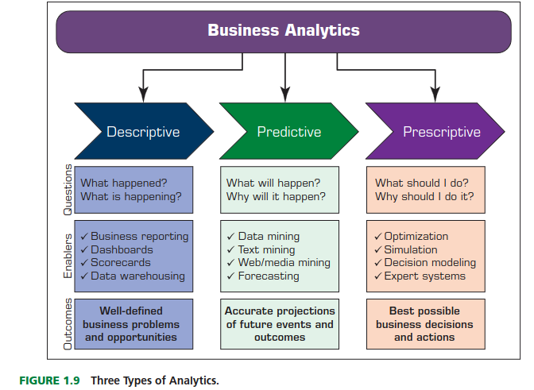
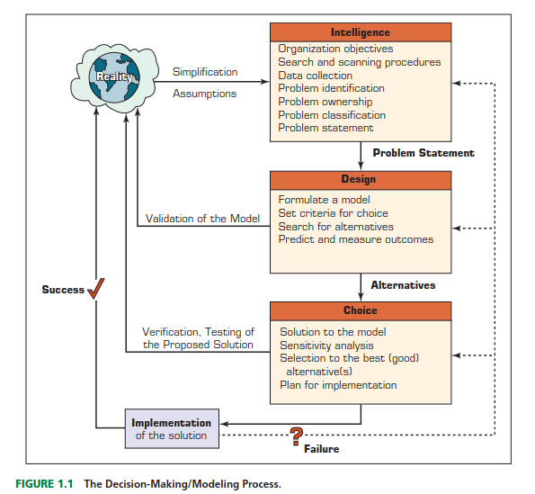
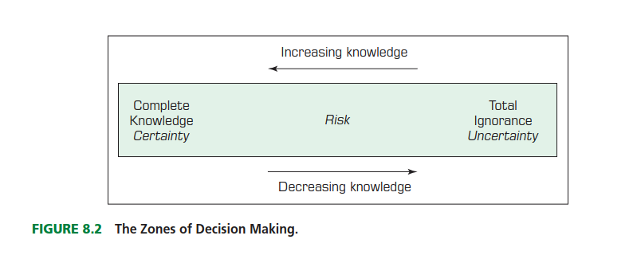
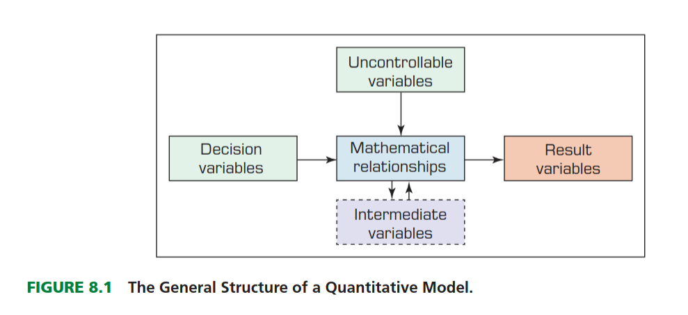

## Toma de decisiones en Business Intelligence

## Toma de desición y soporte en datos

::: {.callout-important}

La toma de decisiones es un proceso de elección **entre dos o más cursos de acción alternativos** con el fin de alcanzar uno o más objetivos. 
:::

- Según Simon (1977), la toma de decisiones gerenciales es sinónimo de todo el proceso de gestión. Consideremos la importante función gerencial de la planificación. 

- La planificación implica una serie de decisiones: ¿Qué se debe hacer? ¿Cuándo? ¿Dónde? ¿Por qué? ¿Cómo? ¿Quién debe hacerlo? 

- Los gerentes establecen objetivos, es decir, planifican; por lo tanto, la planificación implica la toma de decisiones. Otras funciones gerenciales, como la organización y el control, también implican la toma de decisiones.

## El proceso de toma de decisiones

## El proceso de toma de decisiones

::: {.callout-important}

- La fase de selección de alternativas incluye la elección de una solución propuesta para el modelo (no necesariamente para el problema que representa). Esta solución se prueba para determinar su viabilidad.

- Durante este proceso, es necesario predecir el resultado futuro de cada alternativa propuesta.

- Las decisiones las tomamos bajo :
    - Certeza
    - Incertidumbre
    - Riesgo

:::

## Espacio de toma de decisiones según la conocimiento

## Espacio de toma de decisiones según la conocimiento

- En la toma de decisiones **bajo certeza**, se asume que se dispone de información completa, de modo que quien toma la decisión sabe con exactitud cuál será el resultado de cada curso de acción (como en un entorno determinista).

- En la toma de decisiones en **condiciones de incertidumbre**, quien toma la decisión considera situaciones en las que son posibles varios resultados para cada curso de acción. 

- Una **decisión tomada bajo riesgo** es aquella en la que quien toma la decisión debe considerar varios resultados posibles para cada alternativa, cada uno con una probabilidad de ocurrencia determinada.

# Análisis Cuantitativo {background-color="#790cee"}

## Modelar la toma de decisiones

## Modelar la toma de decisiones

- Un modelo matemático es una **representación simplificada** de la realidad que utiliza el lenguaje, los símbolos y las estructuras de las matemáticas para describir, explicar o predecir el comportamiento de un sistema.

- Optimizar: Encontrar la mejor forma de asignar recursos.
- Predecir: Anticipar escenarios futuros bajo condiciones específicas.
- Controlar: Entender qué palancas mover para obtener un resultado deseado.

## Evaluación de alternativas

Para evaluar con rigor distintas alternativas de acción en BI, es fundamental integrar:

1.  **Rigor Estadístico:** Mediante simulaciones.
2.  **Flexibilidad:** Incorporando criterios cualitativos.
3.  **Robustez:** Entendiendo el impacto de la incertidumbre.

## El Modelado de la incertidumbre

El núcleo de la evaluación reside en entender cómo varían los **KPIs** ante cambios en los supuestos de entrada.

::: {.incremental}
- **Análisis de sensibilidad:** Identifica qué variables generan mayor variación de los indicadores clave. Se debe definir valores mínimimos y máximos como supuestos o escenarios.
- **Simulación de Monte Carlo:** Genera rangos de probabilidad en lugar de números estáticos. Útil para ver en términos de probabilidad todos los escenarios posibles.
:::

## Ejemplo 1. ¿A quién le ofrezco un descuento?

**Segmentación de clientes**

Estimación de respuestas individualizadas a incentivos

**Pregunta:** Un servicio de suscripción de medios desea ofrecer descuentos segmentados mediante un plan de precios personalizado.

**Problema:** Observan muchas características de sus clientes, pero no están seguros de cuáles responderán mejor a un precio más bajo.

**Solución** : Utilizar un modelo donde se utiliza **variaciones de precios** en los datos existentes, junto con un amplio conjunto de **características de usuarios**, para estimar **sensibilidades de precios (elasticidades)** que varían según múltiples características del cliente.

---

## Análisis de sensibilidad (Tornado)

Permite visualizar rápidamente qué factores generan la mayor volatilidad.

**Análisis unidireccional**
Variar una sola variable (ej. precio o costo) manteniendo las demás constantes.

**Diagramas de tornado**
Ranking de variables por su impacto en el resultado final.

---

## Simulación de Monte Carlo

A diferencia de los modelos estáticos, asigna distribuciones de probabilidad a las variables inciertas.

- **Uso:** Evaluación de riesgos en proyectos de inversión.
- **Resultado:** Curva de probabilidad (PDF/CDF).
- **Métrica Clave:** Probabilidad de que el beneficio sea superior a un umbral $X$.

---

## 2. Evaluación Cualitativa {background-color="#fdfcf0"}

No todo es cuantificable. La recomendación debe pasar por filtros estratégicos:

| Factor | Descripción |
|:---|:---|
| **Alineación Estratégica** | ¿Refuerza la visión a largo plazo? |
| **Factibilidad Técnica** | ¿Contamos con la infraestructura y talento? |
| **Impacto Reputacional** | Efecto en clientes y stakeholders. |

---

## 3. Matriz de Decisión (MCDA)

Unificamos ambos mundos mediante un modelo de puntuación ponderada.

### Cálculo del Score Total

$$S_i = \sum_{j=1}^{n} w_j \cdot c_{ij}$$

Donde:
- $w_j$: Peso o importancia relativa del criterio $j$ ($\sum w = 100\%$).
- $c_{ij}$: Calificación de la alternativa $i$ en el criterio $j$ (Escala 1-10).

---

## Ejemplo de Estructura de Evaluación

| Criterio | Peso ($w$) | Opción A (Status Quo) | Opción B (Inversión) |
|:---|:---:|:---:|:---:|
| **Rentabilidad (Simulación)** | 40% | 5 | 9 |
| **Riesgo (Sensibilidad)** | 20% | 8 | 4 |
| **Factibilidad** | 20% | 9 | 5 |
| **Estrategia** | 20% | 6 | 9 |
| **Total Ponderado** | **100%** | **6.6** | **7.2** |

---

## Recomendación Final

La opción más beneficiosa debe cumplir con:

1.  **Dominancia Estocástica:** Mayor probabilidad de éxito en los escenarios más probables (p50).
2.  **Resiliencia:** Desempeño aceptable en el "peor escenario" identificado.
3.  **Sostenibilidad:** Viabilidad operativa a largo plazo.

::: {.notes}
Es importante recordar que el BI no decide por el humano, sino que reduce la incertidumbre para que el humano decida con datos.
:::